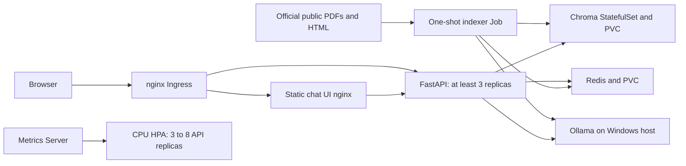

# RAHBAR architecture

The existing UI is plain HTML/CSS/JavaScript supplied with the starter, rather
than React. It sends a same-origin POST to `/api/ask`; there is no Node build step.
The Ingress sends `/api` and API health/metrics endpoints to FastAPI, and `/` to
the UI. nginx in the UI also proxies `/api/` so direct UI access can work.

Only the indexer writes the serving Chroma collection. Indexing never runs at
API startup. The Job extracts PDF/HTML, attempts OCR on image-only pages, cleans,
chunks and embeds with `nomic-embed-text`. Metadata includes document version,
superseded status, page, section and source provenance. The API and indexer read
the same embedding model from the ConfigMap. API readiness fails on an empty
collection or an embedding-model mismatch; liveness only checks the process.

Chroma is a StatefulSet because its stable identity and `volumeClaimTemplates`
bind `chroma-0` to its own persistent volume across pod replacement. It has a
ClusterIP Service, not an externally exposed database port. Redis persists its
append-only data on a separate PVC; the corpus has a third independent PVC.
Do not delete these PVCs to restart or repair the application.

Ollama runs on the host, reached through `host.docker.internal:11434` in Docker
Desktop. Its downloaded models stay outside the Kubernetes pod filesystem.
`qwen3:1.7b` generates schema-constrained answers at temperature 0.2. Model
reasoning is omitted from the API response. Citation validation permits only
retrieved source/section/page tuples; invalid output is retried once and then
falls back to an abstention.

Redis cache keys include a content-derived index version. Follow-ups,
abstentions and validation failures are not cached. CPU scaling measures API
work, not host inference load: request queue length or in-flight generation
requests would be a better future autoscaling signal.

NetworkPolicy manifests deny by default and permit DNS, Ingress-to-UI/API,
UI-to-API, API/indexer-to-Chroma, API-to-Redis, indexer-to-Redis cache invalidation,
and development Ollama egress.
Manifest presence alone does not prove enforcement; consult the measured
network probes in `docs/evidence/current/`.

Known implementation limits to assess before a production deployment: the
current indexer replaces a collection when storing a new index, so a reindex
can briefly make readers unready; it does not atomically switch collections.
Chroma and Redis run as UID/GID 10001 with read-only root filesystems and writable
data PVCs. Migrating volumes previously written by root requires the explicit
one-time ownership migration in `k8s/volume-permissions.yaml`; it changes ownership,
not file contents. That maintenance pod needs root and narrow filesystem
capabilities, and is not part of normal application deployment.
